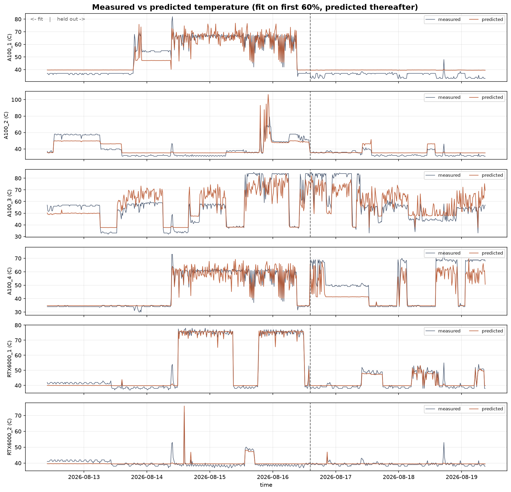
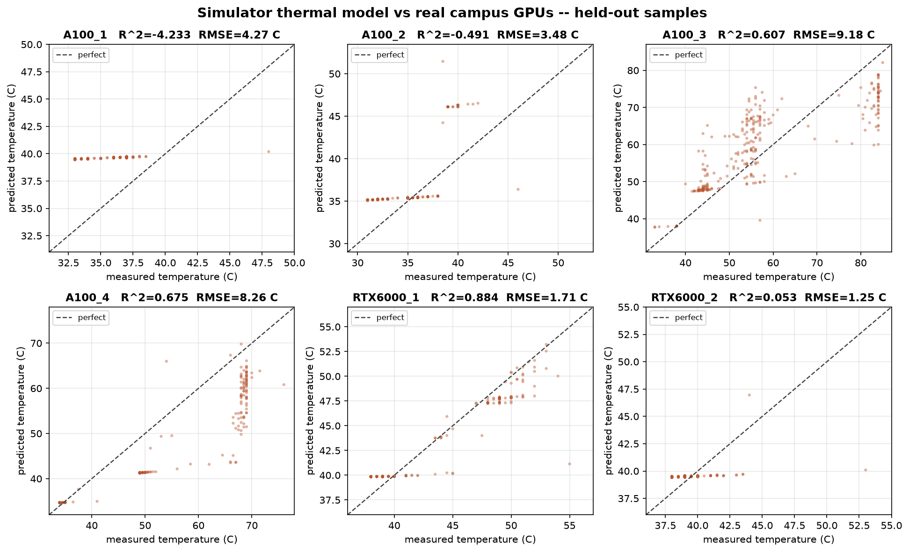

# Spatial-Phase RL Scheduler for LLM Inference

> A learned scheduler that places LLM inference jobs across a 6×6 grid of mixed H100/A100 GPUs, trading throughput against thermal load. The simulator models continuous batching, 2D Laplacian heat diffusion and real thermal throttling, and is validated against a week of telemetry from six real campus GPUs.

---

## Problem Statement

Large Language Model inference creates **thermal stacking** in data centers because its two phases are structurally different:

| Phase    | Compute Profile               | Thermal Signature                        |
|----------|-------------------------------|------------------------------------------|
| Prefill  | Compute-bound (FLOP-heavy)    | 200–700 W — approaches GPU TDP           |
| Decode   | Memory-bound (autoregressive) | 70–350 W — cooler, latency-sensitive     |

Conventional schedulers (round-robin, least-loaded) are **spatially blind** — they have no model of cluster topology or device heat, so they create localized hotspots that trigger thermal throttling, cascading tail-latency spikes, and sustained thermal stress on hardware.

## Solution Architecture

An agent observes the full thermal and capacity state of a **6×6 heterogeneous GPU grid** and places each queued job:

```
Incoming LLM job → shortlist of 6 candidate cells → agent → place on GPU (row, col)
                 → continuous batching → heat injection → diffusion → throttling → reward
```

### How the agent is actually trained — read this before quoting results

**PPO from a random initialisation does not solve this task.** That is a measured result, reproducible with `train_agent.py`, not a tuning failure. It was tested across discount 0.99–0.999, entropy bonuses, a spatial policy head, separate actor/critic feature extractors, a work-conserving mask, immediate placement credit, fixed single-window episodes and 300k timesteps. In every configuration the policy converged to or below a uniform-random policy.

The cause is exploration, not representation. Cloning the best heuristic reaches **95% action agreement**, so the network can express a good policy comfortably. It cannot *find* one: 37 discrete actions, a reward whose largest term (+10 per placement) is nearly independent of which cell is chosen, and thermal consequences that land 70+ steps later across 36 cells.

The shipped agent therefore uses a **two-stage offline route**:

1. **`pretrain_bc.py`** — behaviour-clone the Best-Fit heuristic (~95% agreement). Imitation only; this stage cannot beat its teacher.
2. **`offline_rl.py`** — roll out *perturbed* copies of the teacher, keep only the episodes that **actually beat it**, and train on those. The training signal is the observed return, not the teacher's choice, which is what makes this reinforcement learning rather than imitation.

This must be stated in any write-up. It is standard offline RL (filtered behaviour cloning / reward-weighted regression), and it is *not* PPO-from-scratch.

---

## System Architecture Diagram

```
┌──────────────────────────────────────────────────────────────────────────┐
│                          FUSED DATASET PIPELINE                          │
│                                                                          │
│  ┌─────────────────────┐          ┌──────────────────────────────┐       │
│  │   Azure LLM Trace   │          │    GPU Hardware Profiles     │       │
│  │   (software layer)  │          │   (hardware physics layer)   │       │
│  │  • arrival_time     │─────────▶│  H100: 700W TDP, 87°C thr.   │       │
│  │  • prefill_tokens   │  FUSE    │  A100: 400W TDP, 85°C thr.   │       │
│  │  • decode_tokens    │          │  W/token, ms/token per phase │       │
│  └─────────────────────┘          └──────────────────────────────┘       │
│            │  arrival_accel scales offered load (default 1.0 = recorded)  │
│            ▼                                                             │
│   Fused Job DataFrame (deferred physics): tokens + per-job efficiency     │
│   fractions. Watts/durations are NOT job properties — they are resolved   │
│   per (job, cell) at placement time.                                      │
└──────────────────────────────────────────────────────────────────────────┘
                                    │
                                    ▼
┌──────────────────────────────────────────────────────────────────────────┐
│                     THERMAL GRID ENVIRONMENT (Gymnasium)                  │
│                                                                          │
│  6×6 grid, checkerboard H100/A100, 3 concurrency slots per cell           │
│                                                                          │
│  ┌────┬────┬────┬────┬────┬────┐    Observation (Dict, 9 keys):          │
│  │H100│A100│H100│A100│H100│A100│      temperatures    [6×6]  °C          │
│  ├────┼────┼────┼────┼────┼────┤      power_draw      [6×6]  W           │
│  │A100│H100│A100│H100│A100│H100│      occupancy       [6×6]  s remaining │
│  ├────┼────┼────┼────┼────┼────┤      tdp_normalized  [6×6]  capability  │
│  │H100│A100│H100│A100│H100│A100│      utilization     [6×6]  P / TDP     │
│  ├────┼────┼────┼────┼────┼────┤      slot_fill       [6×6]  jobs / K    │
│  │A100│H100│A100│H100│A100│H100│      action_mask     [37]               │
│  ├────┼────┼────┼────┼────┼────┤      queue_stats     [2]                │
│  │H100│A100│H100│A100│H100│A100│      head_job        [4]   ← job size   │
│  ├────┼────┼────┼────┼────┼────┤                                          │
│  │A100│H100│A100│H100│A100│H100│    Action: Discrete(37)                 │
│  └────┴────┴────┴────┴────┴────┘      36 cells + Wait, narrowed to a      │
│                                       6-candidate shortlist by the mask   │
│                                                                          │
│  Per step:  power = idle + Σ(resident jobs)  clamped to TDP               │
│             heat injection  →  2D Laplacian diffusion  →  Newton cooling  │
│             cells over threshold execute at 60% speed (real throttling)   │
│                                                                          │
│  Reward = +10 (placed) − 0.1·queue_len − 3.0·Σ (max(0,T−T_thr)/T_thr)²    │
└──────────────────────────────────────────────────────────────────────────┘
```

Three observation channels exist specifically to make the decision learnable:

- **`tdp_normalized` + `utilization`** make heterogeneity visible — a 400 W draw is 57% of an H100's ceiling but 100% of an A100's.
- **`slot_fill`** is distinct from `occupancy`: under batching a cell can be nearly done on *time* yet full on *slots*.
- **`head_job`** exposes the job about to be placed (`[prefill_tokens/4096, decode_tokens/1024, prefill_watt_frac, decode_watt_frac]`). Without it a 4,107-token prefill and a 2-token one are byte-identical inputs and the policy schedules blind.

---

## The Fused Dataset Pipeline

Two orthogonal signal layers, resolved **at placement time**, not at fusion time.

### Layer 1 — Software traffic (Azure LLM Inference Trace 2023, real data)

Microsoft's [Azure LLM Inference Trace 2023](https://github.com/Azure/AzurePublicDataset) provides production request patterns. `AzureTraceLoader` downloads the real CSVs into `data/AzurePublicDataset/` on first use.

| Trace file | Workload | Requests | Span |
|---|---|---|---|
| `AzureLLMInferenceTrace_conv.csv` | Conversational chat | 19,366 | ~1 hour |
| `AzureLLMInferenceTrace_code.csv` | Coding copilot | 8,819 | ~1 hour |

`TIMESTAMP → arrival_time`, `ContextTokens → prefill_tokens`, `GeneratedTokens → decode_tokens`.

**`arrival_accel`** compresses inter-arrival gaps to scale offered load without touching token counts, physics, or arrival order. **Default 1.0 — the recorded rate, no scaling.** It exists because the trace was served by a fleet far larger than 36 GPUs; it is a supported knob, not something the shipped configuration relies on.

### Layer 2 — Hardware physics

Per-device constants in `configs/hardware_profiles.py`, keyed by GPU model: TDP, idle power, throttle temperature, power→heat coefficient, and per-phase watts/latency per token.

### Deferred physics

Watts and durations are properties of a **(job, GPU) pair**, not of a job. The fused frame carries token counts plus hardware-agnostic efficiency fractions; `resolve_job_physics()` converts them against whichever cell the scheduler picks. On a mixed grid the target device is unknown until the agent acts, so resolving earlier would be wrong.

### GPU support guard

Every device on the grid must have a calibrated profile **and** be declared supported by the dataset (`validate_grid_support`, set-based). This makes mixed grids possible while still rejecting hardware the dataset was never prepared for.

---

## 6×6 Spatial Thermodynamic Grid

### Heat diffusion model

```
∂T/∂t = η[i,j] · P[i,j] + α · ∇²T − γ · (T − T_ambient)
```

- `η[i,j]` — per-cell power→heat coefficient (device-specific thermal resistance)
- `α = 0.15` — thermal diffusivity, scalar even on mixed grids (interface conductance between adjacent packages)
- `γ = 0.14` — cooling toward ambient 25 °C
- `∇²T` — discrete 4-neighbour Laplacian, Neumann boundary

`src/environment/physics_engine.py` implements each term as an independent pure function.

### Continuous batching (concurrency)

Each cell hosts up to **`max_jobs_per_cell = 3`** concurrent jobs, as real inference servers do. Cell power is `idle + Σ(marginal draws)`, clamped to that cell's TDP. Concurrent jobs share the device, so each runs slower:

```
effective dt for a job = TIMESTEP / (1 + β · (n_jobs_on_cell − 1))
β_prefill = 0.85   (compute-bound, batches poorly — near-serial)
β_decode  = 0.25   (memory-bound, batches well — near-parallel)
```

That asymmetry is the same prefill/decode split the project is built on, now expressed in the **execution model** rather than only in wattage. At `n_jobs = 1` both reduce exactly to `TIMESTEP`, so `max_jobs_per_cell=1` reproduces the single-job environment bit for bit — asserted in the test suite.

**Why this is not optional.** At one job per cell, under load the action mask leaves **0–1 legal cells on ~95% of decisions** (mean 0.36 of 36). There is no decision to make, and every scheduler — learned or not — scores identically. Concurrency restores ~30 legal cells per decision and is what makes the problem an MDP at all.

### Thermal throttling

A cell above its own threshold downclocks: every resident job executes at **`THROTTLE_SPEED_FACTOR = 0.6`**. This makes temperature *consequential* rather than cosmetic — packing a cell hot delays its jobs, which holds slots longer, which backs up the queue and raises TTFT. That is a delayed cost a myopic policy cannot see coming.

### Scheduling model: backlog queue, work-conserving mask, candidate shortlist

Jobs enter a **persistent backlog queue** on their real arrival timestamps (clock advances 0.1 s per step) and are never dropped. Three constraints shape the action mask:

1. **Capacity** — a cell is legal only while `slots_used < max_jobs_per_cell`.
2. **Work-conserving** — Wait is removed whenever any slot is free and work is queued. Every heuristic baseline already behaves this way; it also stops the action-independent +10 placement reward from drowning the cell-choice signal.
3. **Candidate shortlist** (`candidate_k = 6`) — the policy chooses among the 6 least-loaded, coolest legal cells, **stratified by device type** so both H100 and A100 always remain on the menu. Ranking uses only load and heat, never job size or device capability, so the job-to-device matching the agent must learn is left entirely to it.

Feasibility is slot-count only — no VRAM or KV-cache capability check. A known gap, not a hidden invariant.

### Reward signal

`R = R_place − R_sla − R_thermal`, per step:

| Component | Value | Purpose |
|---|---|---|
| `R_place`   | +10 if a job was placed | Encourage scheduling over idling |
| `R_sla`     | `0.1 × queue_length` | Latency pressure — queued jobs cost every step |
| `R_thermal` | `3.0 × Σ (max(0, T[i,j] − T_thr[i,j]) / T_thr[i,j])²` | Quadratic penalty on normalised excess |

Two design points worth stating in a write-up:

**`R_sla` charges queue occupancy, not accumulated wait.** Summed over an episode this equals `0.1/dt ×` (total queueing seconds) — linear in total delay, the standard Little's-law form. Charging `Σ(now − arrival)` every step double-integrates: a job waiting *T* seconds costs O(*T*²), reaching ~10⁶ on a 500-job episode and making "never schedule anything" optimal.

**`R_thermal` normalises excess by each cell's own threshold before squaring.** Raw degrees-squared explodes once concurrency pushes cells past threshold — at 110 °C it reaches ~1,600/step against a +10 placement reward, making stalling optimal by a factor of 35. Normalised, it lands at ~24% of the placement reward. It also makes the penalty dimensionless, so an A100 5 °C over its 85 °C limit and an H100 5 °C over its 87 °C limit are scored as equally stressed — which is what you want on a mixed grid.

`THERMAL_PENALTY_COEFF = 3.0` was chosen by sweep: at 0.5 the thermal term is 4% of the placement reward and ignorable; at 5.0 it reaches 39% and dominates throughput.

---

## Results

All numbers below are on **held-out** trace rows (4000+), disjoint from the 0–4000 training pool, on the 6×6 checkerboard grid with 3 slots per cell.

### Headline comparison — single held-out slice (rows 4000–4500)

| Policy | P99 TTFT (s) | SLA % | TTTR | Throttled work | Peak °C | Makespan (s) |
|---|---|---|---|---|---|---|
| **Best-Fit** | 0.469 | 100.0 | **0.345** | **0.529** | **113.1** | 159.1 |
| **Spatial-Phase RL** | 0.469 | 100.0 | 0.386 | 0.542 | 115.8 | 165.3 |
| Least-Occupied | 0.469 | 100.0 | 0.410 | 0.594 | 117.5 | 154.4 |
| Thermal-Greedy | 0.469 | 100.0 | 0.544 | 0.611 | 118.3 | 147.7 |
| Round-Robin | 4.010 | 100.0 | 0.773 | 0.792 | 122.9 | **143.9** |

### Across eight held-out slices (mean episode reward)

| Policy | Mean reward | RL vs. this |
|---|---|---|
| Best-Fit | **4110** | RL −3.5% (paired t ≈ −1.85) |
| **Spatial-Phase RL (offline)** | **3968** | — |
| Least-Occupied | 3278 | RL **+21%** |
| Thermal-Greedy | 2628 | RL **+51%** |
| Round-Robin | 1165 | RL **+240%** |

**The defensible claim:** *the learned policy matches the strongest capability-aware heuristic within noise, and outperforms the three standard baselines by 21–240%.*

**What must not be claimed:** that RL beats all baselines. Best-Fit is a tie-to-slight-loss, and Best-Fit is a baseline written specifically so the comparison would be honest — it reads the same `head_job` features the agent does and combines job size, device capability, contention and throttle risk.

### Negative result — PPO from scratch

Reproducible with `train_agent.py`. A representative held-out evaluation: `reward −419.5, TTTR 0.790, throttled work 74.9%` — worse than every baseline. Report this as a finding, not a bug. Its diagnosis (exploration, not representation — 95% clonable but unreachable by search) is one of the more interesting things in the project.

### Known limitations

- **Single seed.** No error bars on the headline comparison. The −3.5% vs Best-Fit is not statistically separable from zero.
- **The agent was trained from Best-Fit demonstrations** filtered by return. Legitimate offline RL, but the method must be stated.
- **H100 thermal constants are unvalidated.** Campus telemetry covers A100 and RTX6000 only; the experiments run on an H100/A100 grid.
- **A100 and RTX6000 `power_to_heat` are ~1.7×/1.9× higher than the campus fit implies** and are deliberately left uncorrected — see the Stage 8 section.

---

## Project Structure

```
RL/
├── README.md
├── requirements.txt
├── pytest.ini                     # testpaths = tests
├── .gitignore
├── data/
│   └── AzurePublicDataset/        # Real Azure trace CSVs (auto-downloaded)
├── configs/
│   ├── __init__.py                #   PROJECT_ROOT, DATA_DIR, MODELS_DIR, re-exports
│   └── hardware_profiles.py       #   GPU_HARDWARE_PROFILES, resolve_job_physics, guards
├── src/
│   ├── data_pipeline/             # Module 1 — ingestion & fusion
│   │   ├── trace_loader.py        #   AzureTraceLoader (offset slicing)
│   │   └── workload_fuser.py      #   WorkloadFuser (+ arrival_accel)
│   ├── environment/               # Module 2 — Gymnasium physics environment
│   │   ├── thermal_env.py         #   ThermalGridEnv: batching, throttling, shortlist
│   │   ├── physics_engine.py      #   Laplacian diffusion, Newton cooling, heat injection
│   │   └── action_masking.py      #   Slot-based mask (+ work-conserving)
│   ├── models/                    # Module 3 — learning & reporting
│   │   ├── spatial_cnn.py         #   6-channel CNN + queue/job MLP, per-cell scoring head
│   │   ├── train_agent.py         #   MaskablePPO/PPO pipeline + ablation CLI
│   │   ├── pretrain_bc.py         #   Stage A: behaviour-clone Best-Fit
│   │   ├── offline_rl.py          #   Stage B: return-filtered offline RL  ← ships the agent
│   │   ├── campus_deployment_eval.py  # Zero-retraining eval on the real campus fleet
│   │   ├── extract_diagnostics.py #   TensorBoard scalars -> CSV
│   │   ├── plot_ablation_results.py
│   │   └── generate_report.py     #   Full report: 7 plots + results.json + REPORT.md
│   └── baselines/                 # Module 4 — comparative schedulers
│       ├── round_robin.py         #   Spatially blind cyclic placement
│       ├── least_occupied.py      #   Fewest resident jobs (load-aware)
│       ├── thermal_greedy.py      #   Coldest legal cell
│       ├── best_fit.py            #   Shortest estimated completion time (strongest)
│       ├── trained_policy.py      #   Wraps a checkpoint in the scheduler API
│       ├── separation_gate.py     #   Pre-flight: is this environment worth training on?
│       └── run_baselines.py       #   Unified benchmark harness
├── tests/
│   └── system_architecture_test.py
├── tools/                         # Standalone hardware utilities (not in the RL pipeline)
│   ├── gpu_profiler.py
│   └── gpu_plot.py
├── Clg_Data/                      # Campus telemetry & sim-to-real validation (Stage 8)
│   ├── identify_clg_gpus.py
│   ├── finalize_clg_dataset.py
│   ├── validate_physics_against_real_gpu.py
│   ├── gpu_telemetry_identified.csv           # derived, tracked
│   ├── physics_validation_results.csv         # derived, tracked
│   ├── physics_validation_parity.png          # figure, tracked
│   └── physics_validation_timeseries.png      # figure, tracked
└── artifacts/                     # Generated outputs (gitignored except .gitkeep)
    ├── models/  logs/  diagnostics/  plots/  report/
```

The 26 raw week-wise Grafana exports under `Clg_Data/` are **gitignored** — bulky, and only consumed by `finalize_clg_dataset.py`. The derived CSVs and figures are tracked, so a fresh clone can re-run the physics validation without them.

Every path is anchored to `configs.PROJECT_ROOT`, so entry points behave identically regardless of working directory.

---

## Quickstart

### Install

```bash
pip install -r requirements.txt
```

The real Azure trace auto-downloads on first use.

### Minimum path to a full set of results

Run **in order** — each step depends on the one before it.

```bash
python -m pytest -q                                    # 1. verify the build        ~1 s
python -m src.baselines.separation_gate --jobs 500     # 2. is training worthwhile? ~30 s
python -m src.models.pretrain_bc                       # 3. clone the teacher       ~3 min
python -m src.models.offline_rl                        # 4. offline RL  ← the agent ~8 min
cp artifacts/models/offline_rl.zip artifacts/models/spatial_thermal_ppo.zip
python -m src.models.generate_report --jobs 500        # 5. the report              ~2 min
```

Open `artifacts/report/REPORT.md`.

> **Step 5 requires the `cp`.** `generate_report` and `campus_deployment_eval` both look for `spatial_thermal_ppo.zip`. Every `train_agent` run overwrites that file, so re-copy after any training run or the report will evaluate the wrong model.

---

## Commands, in order

Every command below lists its **defaults** so you can see what to vary.

### 1. Verify the build

```bash
python -m pytest -q
python tests/system_architecture_test.py      # same assertions, verbose
```

Asserts physics invariants element-wise, `max_jobs_per_cell=1` backward compatibility, concurrency and TDP clamping, the work-conserving mask, and that `head_job` decodes the real token counts.

**Depends on:** nothing. If this fails, stop — everything downstream is meaningless.

### 2. Separation gate — is the environment worth training on?

```bash
python -m src.baselines.separation_gate --jobs 500
python -m src.baselines.separation_gate --slots 1 --layout homogeneous   # the contrast
```

**Defaults:** `--jobs 500 --grid 6 --layout checkerboard --offset 4000 --slots 3 --accel 1.0`

Checks **two** conditions that pull in opposite directions:

- **BRANCHING** — mean legal cells per decision ≥ 5, and ≤1 option on at most 25% of decisions.
- **SEPARATION** — ≥10% spread on a *consequential* metric (TTFT, TTTR, SLA, makespan), not a descriptive one.

Current config passes at **30.20 legal cells/decision** and **88.3% separation**. The contrast command shows the collapsed case. Checking separation alone is how a configuration with 53.5% single-option decisions once got marked "passing" — hence both.

**Depends on:** nothing.

### 3. Baseline table

```bash
python -m src.baselines.run_baselines --jobs 500
```

**Defaults:** `--jobs None (full trace) --workload conv --gpu-model H100 --grid-size 6 --layout checkerboard --slots 3`

Every CLI now takes its `--slots`, `--layout` and `--accel` defaults from the shared
constants in `train_agent.py`, so no entry point can silently drift from the
experiment configuration. Pass `--slots 1` to reproduce the single-job-per-GPU
environment (the `ThermalGridEnv` constructor still defaults to 1 for backward
compatibility, which is what the test suite pins).

**Depends on:** nothing.

### 4. Behaviour cloning — the warm start

```bash
python -m src.models.pretrain_bc
```

**Defaults:** `--demos 16000 --epochs 40 --lr 3e-4 --batch 512 --seed 0 --layout checkerboard --slots 3`

Produces `artifacts/models/bc_pretrained.zip` at ~95% agreement with Best-Fit. **This is imitation, not RL** — it cannot beat its teacher.

**Depends on:** nothing. Useful on its own as the "can the network represent a good policy?" evidence.

### 5. Offline RL — this produces the reported agent

```bash
python -m src.models.offline_rl
```

**Defaults:** `--episodes 120 --keep-quantile 0.30 --epochs 40 --lr 3e-4 --batch 512 --seed 0`

Rolls out 120 perturbed-teacher episodes, keeps only those that **beat** the deterministic teacher, and trains on them. Produces `artifacts/models/offline_rl.zip`.

**Depends on:** nothing (trains fresh), but this is the step that makes the result RL rather than imitation.

### 6. Promote the agent

```bash
cp artifacts/models/offline_rl.zip artifacts/models/spatial_thermal_ppo.zip
```

**Required** before steps 8 and 9, and again after any `train_agent` run.

### 7. PPO ablations — optional, this is the negative result

```bash
python -m src.models.train_agent --timesteps 100000 --eval
python -m src.models.train_agent --timesteps 100000 --reward-variant no_thermal
python -m src.models.train_agent --timesteps 100000 --no-masking
```

**Defaults:** `--timesteps 100000 --seed 42 --layout checkerboard --grid-size 6 --reward-variant full --slots 3 --arrival-accel 1.0 --candidate-k 6 --n-envs 8 --gamma 0.999 --ent-coef 0.01 --n-steps 1024 --lr 3e-4 --episode-jobs 500`

Training draws a fresh random 500-job window from trace rows 0–4000 each reset; `--eval` scores a fixed disjoint slice at rows 4000–4500.

**Expect these to underperform the baselines** — that is the documented finding.

⚠ Each run **overwrites** `spatial_thermal_ppo.zip`. Re-run step 6 afterwards.
⚠ Reward variants are **not comparable on reward** — `no_thermal` scores higher simply because a penalty term was deleted. Compare them on TTTR and peak temperature instead.

**Depends on:** step 8 needs these logs.

### 8. Extract diagnostics

```bash
python -m src.models.extract_diagnostics
```

**Defaults:** `--logdir artifacts/logs --output artifacts/diagnostics`

Converts TensorBoard events → CSV. When several runs share a variant name, the **longest** wins, ties to the **newest**.

⚠ `artifacts/logs/` accumulates every run ever done. Clear it before a fresh ablation set, or an old run can outlive a new one.

**Depends on:** step 7's logs. Skip it and the report silently drops plots 05–07.

### 9. Generate the report

```bash
python -m src.models.generate_report --jobs 500 --slots 3
```

**Defaults:** `--jobs 500 --workload conv --gpu-model H100 --grid-size 6 --layout checkerboard --slots 3 --accel 1.0 --offset 4000`

Runs all four baselines **plus** the trained agent through one harness and writes to `artifacts/report/`:

| Output | Source | Needs |
|---|---|---|
| `01_baseline_comparison_bar.png` | live episodes | step 6 |
| `02_placement_heatmaps.png` | live episodes | step 6 |
| `03_temperature_timeline.png` | live episodes | step 6 |
| `04_queue_depth_timeline.png` | live episodes | step 6 |
| `05_learning_curves.png` | diagnostics CSVs | **step 8** |
| `06_ablation_summary_table.png` | diagnostics CSVs | **step 8** |
| `07_training_diagnostics.png` | diagnostics CSVs | **step 8** |
| `results.json`, `REPORT.md` | both | both |

`--offset` below 4000 overlaps the training pool; the run still works but prints a warning and records `"trace_split": "training-overlap"` in `results.json`, so a training-set number cannot later be mistaken for a held-out one.

**Depends on:** steps 6 and 8.

### 10. Generalization test

```bash
python -m src.models.campus_deployment_eval
```

Loads the checkpoint **without retraining** and runs it on a 6-cell active mask shaped like the real campus fleet (4× A100 + 2× RTX6000) — hardware and topology the agent never saw, on held-out traffic.

**Depends on:** step 6.

---

## Stage 8 (independent) — Campus GPU telemetry & sim-to-real validation

A **separate pipeline** from the RL track. It takes real Grafana exports from the college cluster (6 physical GPUs — 4× A100, 2× RTX6000 — 7 days, 10-minute sampling) and tests the simulator's thermal model against them. Nothing in steps 1–10 depends on it.

```bash
# 8a. (optional, diagnostic) how device type and file pairing are inferred
python -X utf8 Clg_Data/identify_clg_gpus.py

# 8b. BUILD the labelled dataset  -> Clg_Data/gpu_telemetry_identified.csv
#     Needs the raw Grafana exports, which are gitignored (local only).
python -X utf8 Clg_Data/finalize_clg_dataset.py

# 8c. VALIDATE physics vs reality -> results CSV + 2 figures
#     Runs from the tracked derived CSV, so this works in a fresh clone.
python -X utf8 Clg_Data/validate_physics_against_real_gpu.py
```

`-X utf8` is required: the exports mix UTF-16 TSV and UTF-8 CSV.

| Stage | Script | What it does |
|---|---|---|
| 8a | `identify_clg_gpus.py` | Labels each device by **SM-clock ceiling** (< 1500 MHz → A100, else RTX6000) and cross-correlates power/util against clocks to pair files per physical GPU. Prints only. |
| 8b | `finalize_clg_dataset.py` | Same logic, plus matching the 8 temperature files down to 6 GPUs (2 are duplicate re-exports), resampling to 15 min, writing a 24-column wide CSV. |
| 8c | `validate_physics_against_real_gpu.py` | Fits the thermal model, runs a hold-out prediction test, and emits both figures. |

### What this dataset can and cannot prove

The thermal model's step solution is `T ← T_eq + (T − T_eq)·exp(−γ·dt)` with `T_eq = T_ambient + (η/γ)·P`. Telemetry is sampled every **600 s** while the thermal time constant is `1/γ ≈ 7 s`, so `exp(−γ·dt) ≈ 1e-55` — **the transient is dead at every sample.** Each reading is an independent steady state and the model collapses to a straight line.

> **γ is not identifiable from this data, at any resampling.** Only the ratio **η/γ** (°C per watt) is. Sweeping γ across four orders of magnitude with η/γ fixed gives a **bit-identical RMSE**. Measuring γ needs sub-minute, ideally ~1 s, sampling. Any claim that campus telemetry confirms the simulator's γ is unsupported.

`T_ambient` is fitted, not assumed. Pinning it at 25 °C tilts the line steeper and inflates the slope — which is how the profile constants ended up roughly 2× too high.

### Results — hold-out validation

Fit on the first 60% of the week chronologically, then **predict the remaining 40%**. The split is by time, not random: consecutive 15-minute samples are highly correlated, so a shuffled split would leak.

| GPU | RMSE fit | RMSE held-out | Δ | MAE held-out | T std test | R² held-out |
|---|---|---|---|---|---|---|
| A100_1 | 4.88 | **4.27** | −0.61 | 3.93 | 1.87 | −4.233 ⚠ |
| A100_2 | 6.07 | **3.48** | −2.59 | 2.92 | 2.85 | −0.491 ⚠ |
| A100_3 | 7.88 | 9.18 | +1.30 | 7.75 | 14.65 | 0.607 |
| A100_4 | 3.25 | 8.26 | +5.01 | 6.28 | 14.50 | 0.675 |
| **RTX6000_1** | 1.87 | **1.71** | −0.16 | 1.31 | 5.02 | **0.884** |
| RTX6000_2 | 1.65 | **1.25** | −0.40 | 0.81 | 1.29 | 0.053 ⚠ |

**RMSE held or improved on 4 of 6 devices.** Mean degradation across high-confidence devices: **+1.38 °C**. Best-instrumented device predicts unseen days at **1.71 °C RMSE**.

⚠ **Read RMSE, not R², on the flagged rows.** `R² = 1 − SSres/SStot`, so a near-isothermal held-out window (T std 1.87 °C vs 13.52 in training) collapses `SStot` and drives R² sharply negative *even where RMSE improved*. The `T std test` column marks where this applies. The two devices with comparable test variance give sensible R² (0.607, 0.675).

### Figures



*Six panels, full week, measured vs predicted, with the fit/held-out boundary dashed. RTX6000_1's prediction tracks the measured square-wave load pattern through data the fit never saw.*



*Predicted vs measured on held-out samples only. Honest about where it fails: A100_3 runs biased high, A100_4 biased low at high temperature.*

### Consequence: two profile constants are ~2× too high

`η_implied = (η/γ)_measured × γ_sim`, using high-confidence devices only:

| Device | measured η/γ | implied η at γ=0.14 | `hardware_profiles.py` | off by |
|---|---|---|---|---|
| A100 | 0.147 | **0.0206** | 0.0350 | **1.70×** |
| RTX6000 | 0.137 | **0.0192** | 0.0370 | **1.93×** |

Both are **deliberately left uncorrected**: lowering η makes the grid cooler and weakens the thermal signal the scheduling experiments depend on. Both entries in `configs/hardware_profiles.py` carry a note saying so. This is a stated limitation, not an oversight.

---

## Which command answers which question?

| Question | Command |
|---|---|
| Is the build sane? | `pytest` |
| Does this environment have a decision to make? | `separation_gate` |
| How do the heuristics compare? | `run_baselines --slots 3` |
| Can the network represent a good policy? | `pretrain_bc` (~95% agreement) |
| **Does the learned agent beat the baselines?** | `offline_rl` → `generate_report` |
| Can PPO learn this from scratch? | `train_agent --eval` (it cannot — that's the finding) |
| Does reward shaping matter? | `train_agent --reward-variant ...` |
| Does masking beat penalties? | `train_agent --no-masking` |
| Does it transfer to unseen hardware? | `campus_deployment_eval` |
| Are the physics constants real? | `validate_physics_against_real_gpu` |

---

## Key defaults

| Constant | Value | Where |
|---|---|---|
| Grid size | 6×6 | `ThermalGridEnv.GRID_SIZE` |
| Layout | `checkerboard` H100/A100 | `DEFAULT_LAYOUT` |
| Concurrency slots per cell | 3 | `DEFAULT_SLOTS` |
| Candidate shortlist | 6 | `DEFAULT_CANDIDATE_K` |
| Arrival scaling | 1.0 (recorded rate) | `DEFAULT_ARRIVAL_ACCEL` |
| Training pool / episode / eval | rows 0–4000 / 500 jobs / rows 4000–4500 | `TRAIN_POOL_JOBS`, `EPISODE_JOBS`, `EVAL_OFFSET` |
| Ambient | 25 °C | `AMBIENT_TEMP` |
| Diffusivity α | 0.15 | `THERMAL_DIFFUSIVITY` |
| Cooling γ | 0.14 | `COOLING_COEFF` |
| Timestep | 0.1 s | `TIMESTEP` |
| Batching contention β | 0.85 prefill / 0.25 decode | `PREFILL_CONTENTION`, `DECODE_CONTENTION` |
| Throttle speed factor | 0.6 | `THROTTLE_SPEED_FACTOR` |
| Reward weights | +10 place / 0.1 SLA / 3.0 thermal | `REWARD_VALID_PLACEMENT`, `SLA_PENALTY_WEIGHT`, `THERMAL_PENALTY_COEFF` |
| PPO | γ 0.999, ent 0.01, n_steps 1024 × 8 envs | `DEFAULT_GAMMA`, `DEFAULT_ENT_COEF`, `DEFAULT_N_STEPS`, `DEFAULT_N_ENVS` |

---

## Metric reference

| Metric | Meaning | Direction |
|---|---|---|
| **P99 TTFT (s)** | 99th-percentile queueing delay, arrival → placement. Excludes prefill execution. | lower |
| **SLA goodput / attainment** | Jobs placed within `SLA_TTFT_SECONDS` (5 s), as a rate and a percentage. | higher |
| **TTTR** | Thermal throttle time ratio — fraction of steps with any cell above its own threshold. | lower |
| **Throttled work ratio** | Fraction of all job-execution time spent downclocked — the *throughput cost* of heat, where TTTR only says a cell was hot. | lower |
| **Mean spatial variance (°C²)** | Grid temperature variance averaged over the episode. Descriptive. | lower |
| **Peak temp (°C)** | Hottest cell at any point. | lower |
| **Placement spread** | Std-dev of per-cell placement counts. | lower = more even |
| **Queue depth P50/P95/P99** | Backlog distribution. | lower |

---

## Programmatic usage

```python
from src.data_pipeline import WorkloadFuser
from src.environment import ThermalGridEnv, make_checkerboard_layout

# The shipped configuration: mixed grid, 3 concurrency slots, 6-candidate shortlist
fuser = WorkloadFuser(gpu_models=["H100", "A100"], seed=42)
jobs = fuser.generate_fused_dataset(
    num_requests=500, source="azure", workload="conv",
    offset=4000, arrival_accel=1.0,
)
env = ThermalGridEnv(
    fused_dataset=jobs,
    gpu_layout_matrix=make_checkerboard_layout("H100", "A100"),
    max_jobs_per_cell=3,
    candidate_k=6,
)

# Single job per cell, no shortlist — reproduces the pre-concurrency environment
env_legacy = ThermalGridEnv(fused_dataset=jobs, gpu_model="H100",
                            max_jobs_per_cell=1, candidate_k=None)
```

---

## Technology Stack

| Component | Technology |
|---|---|
| RL framework | Gymnasium (Farama Foundation) |
| Algorithms | MaskablePPO (`sb3-contrib`); offline RL via return-filtered behaviour cloning (PyTorch) |
| Policy network | Custom 6-channel CNN with a per-cell 1×1 scoring head |
| Numerical compute | NumPy |
| Data pipeline | Pandas |
| Plotting | Matplotlib |
| Testing | pytest |
| Language | Python 3.10+ |

---

## Academic Context

**Project Type:** B.Tech CSE-AI, Semester 7 Capstone Project
**Domain:** Reinforcement Learning × Systems Architecture × Thermal Management
**Keywords:** LLM Inference Scheduling, Spatial RL, Thermal-Aware Placement, Continuous Batching, Laplacian Heat Diffusion, Prefill–Decode Asymmetry, Heterogeneous GPU Scheduling, Offline RL

---

## References

1. Microsoft Azure LLM Inference Trace — [Azure Public Dataset](https://github.com/Azure/AzurePublicDataset)
2. MLPerf Inference Benchmark — [mlcommons.org](https://mlcommons.org/benchmarks/inference-datacenter/)
3. NVIDIA H100 Tensor Core GPU Architecture — [NVIDIA Whitepaper](https://resources.nvidia.com/en-us-tensor-core)
4. Gymnasium Documentation — [Farama Foundation](https://gymnasium.farama.org/)
5. Zhong et al., "DistServe: Disaggregating Prefill and Decoding for Goodput-Optimized LLM Serving" (OSDI 2024)
6. Patel et al., "Splitwise: Efficient Generative LLM Inference Using Phase Splitting" (ISCA 2024)
7. Kwon et al., "Efficient Memory Management for Large Language Model Serving with PagedAttention" (SOSP 2023) — continuous batching

---

## License

Developed for academic purposes. All referenced datasets and benchmarks are used under their respective licenses.
